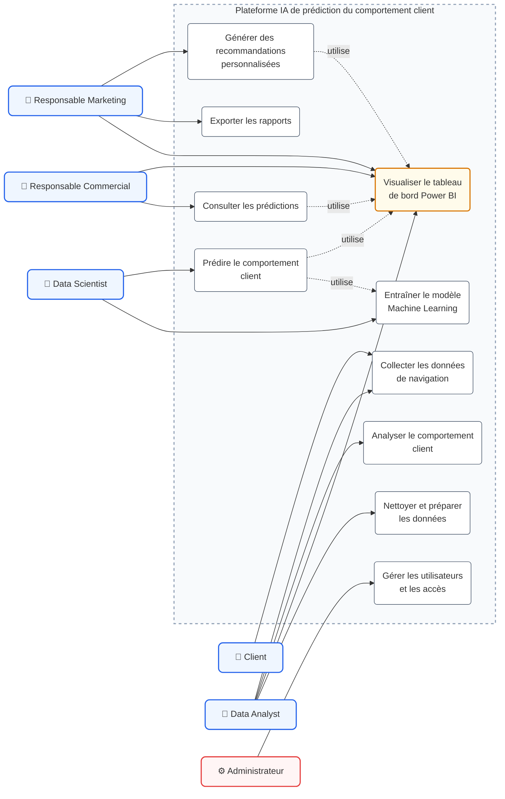
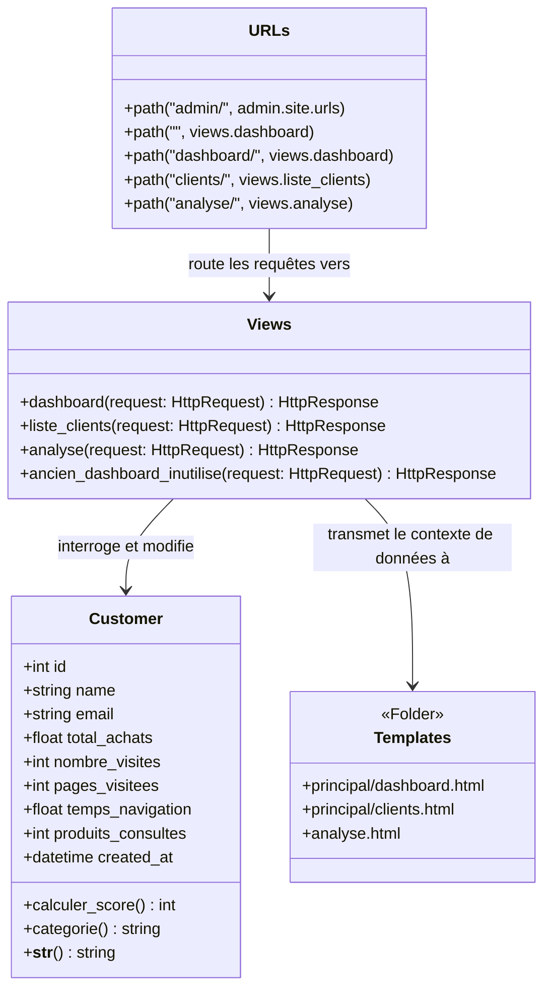
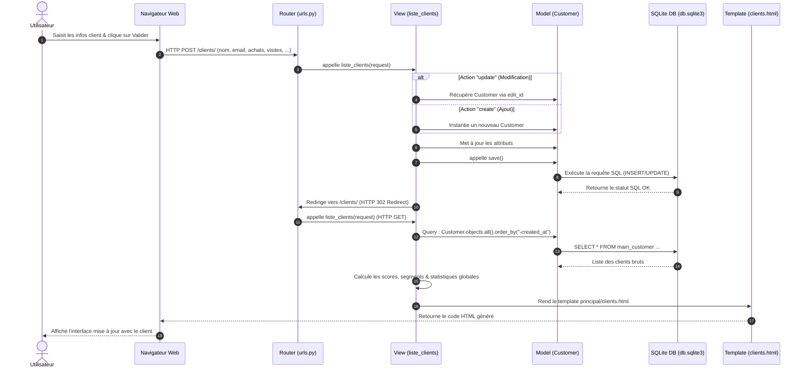

# Architecture et modélisation UML - SmartCustomer Analytics

Ce document rassemble l'architecture technique, l'organisation du code et les diagrammes UML de l'application **SmartCustomer Analytics (Analyse intelligente des clients)**. Il décrit le projet sans en modifier le fonctionnement.

## 1. Architecture technique

- **Backend** : Python 3 et Django 5+ (architecture MVT : Model-View-Template).
- **Machine Learning et traitement des données** : `scikit-learn` (K-Means) et `numpy`.
- **Base de données** : SQLite 3 (`db.sqlite3`).
- **Interface** : HTML5, CSS3 et JavaScript (ES6+).
- **Visualisation** : Chart.js et Mermaid.js pour les diagrammes UML.

### Organisation des fichiers

```text
SmartCustomer_Analytics/
├── README.md
├── Architecture_UML.md
└── Analyse_intelligente_des_clients/
    ├── manage.py
    ├── db.sqlite3
    ├── main/
    │   ├── models.py
    │   ├── views.py
    │   ├── urls.py
    │   ├── tests.py
    │   └── templates/
    │       ├── base.html
    │       ├── analyse.html
    │       └── principal/
    │           ├── dashboard.html
    │           ├── clients.html
    │           ├── ia.html
    │           ├── powerbi.html
    │           └── uml.html
    └── Analyse_intelligente_des_comportements_clients/
        ├── settings.py
        └── urls.py
```

---

## 2. Diagramme des Cas d'Utilisation (Use Case Diagram)

Ce diagramme modélise les exigences fonctionnelles de la plateforme. Il délimite le périmètre du système en définissant les acteurs métiers (**Responsable Marketing**, **Client**, **Data Analyst**, **Responsable Commercial**, **Data Scientist**, et **Administrateur**) ainsi que leurs cas d'utilisation associés au sein de la plateforme IA.



---

## 3. Diagramme de Classes (Class Diagram - Architecture MVT)

Ce diagramme représente la structure statique de l'application en adaptant le patron de conception **MVT (Model-View-Template)** de Django. Il montre la structure du modèle `Customer`, la logique des vues, le routage des URL et les pages de rendu.



### Détails des attributs du modèle `Customer` :
- **`total_achats`** : Somme cumulée dépensée par le client (sert de base de calcul pour 40% du score).
- **`nombre_visites`** : Nombre de fois que le client est venu sur le site (sert de base pour 10 points par visite).
- **`pages_visitees`** : Nombre total de pages consultées (5 points par page).
- **`temps_navigation`** : Temps total passé en secondes (2 points par seconde).
- **`produits_consultes`** : Nombre de produits consultés (3 points par produit).

### Calcul du score et de la catégorie :
Le score est calculé par la méthode `calculer_score()` :
$$\text{Score} = \left(\frac{\text{total\_achats}}{10000} \times 40\right) + (\text{nombre\_visites} \times 10) + (\text{pages\_visitees} \times 5) + (\text{produits\_consultes} \times 3) + (\text{temps\_navigation} \times 2)$$

La méthode `categorie()` renvoie le profil du client en fonction de son score :
- **VIP** : Score $\ge 80$
- **Fidele** : Score $\ge 50$
- **Potentiel** : Score $\ge 20$
- **Nouveau** : Score $< 20$

---

## 4. Diagramme de Séquence (Sequence Diagram)

Ce diagramme illustre le flux dynamique d'une requête de création ou de mise à jour de client via l'interface, montrant comment les vues interagissent avec le modèle, la base de données et le template.


